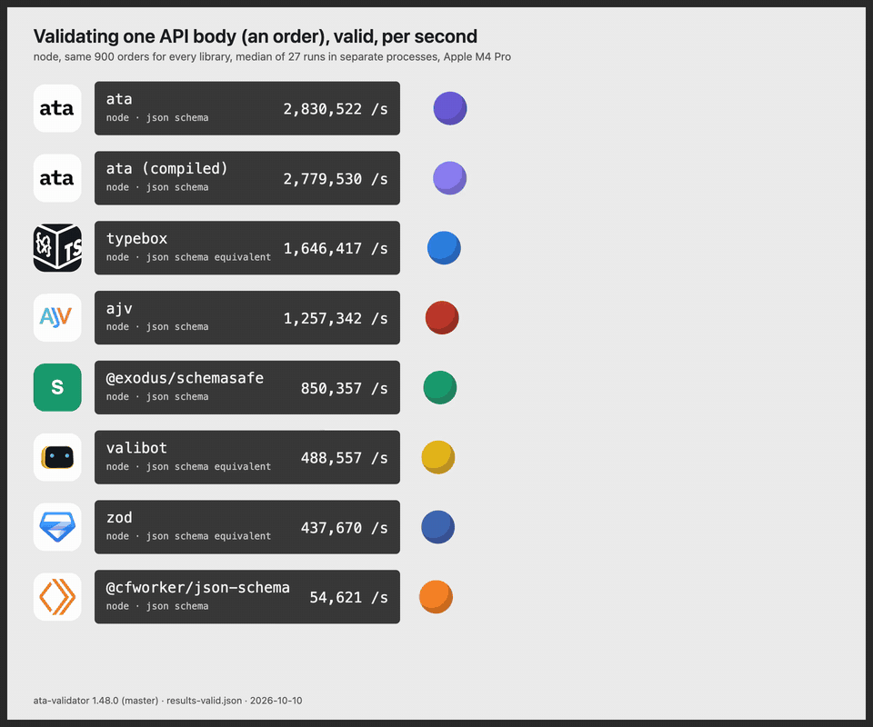
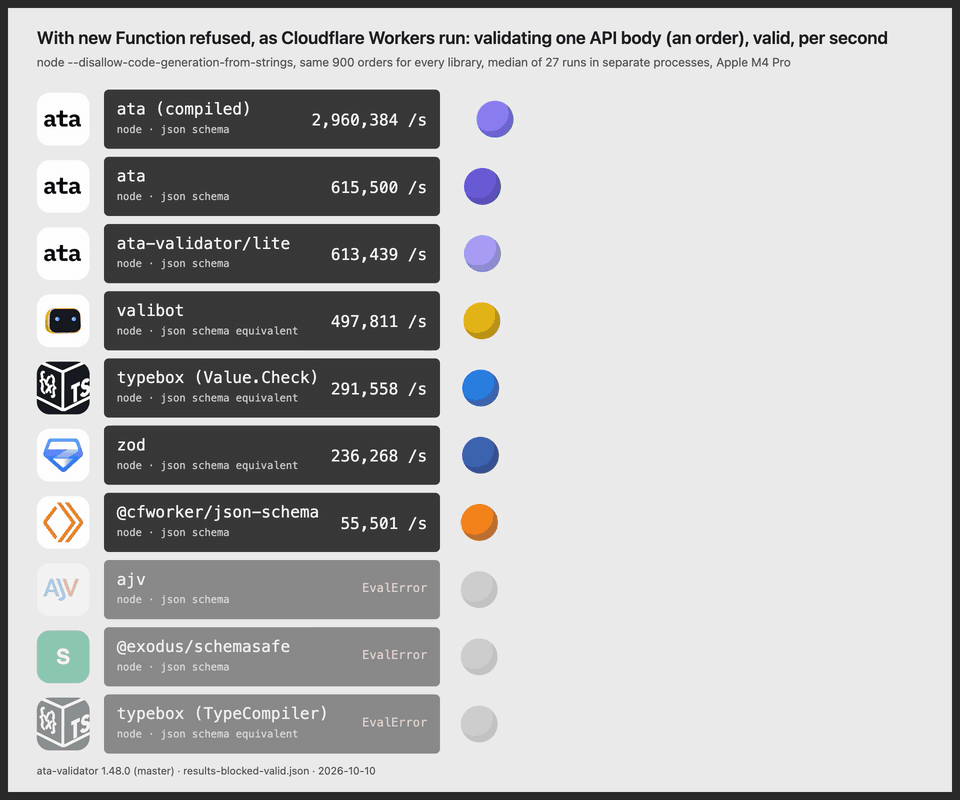

# ata race

Validations per second of one realistic API body across JSON Schema validators and
their TypeScript-first equivalents, rendered as a bouncing-ball list.

The body is an order: customer (id, email, name, phone), 1 to 50 items with a sku
pattern, quantity, price and a currency enum, a shipping address, a uuid, an email and
a date-time. 900 valid orders from a generated corpus, parsed once; every library sees
the same objects.

## The video



Full quality: [media/race-valid-hq.mp4](media/race-valid-hq.mp4) (1920x1600, 60 fps).
The same with code generation refused, the rule Cloudflare Workers enforce:
[media/race-blocked-valid-hq.mp4](media/race-blocked-valid-hq.mp4), preview below.
Also in `media/`: the invalid-body runs and an ata against @cfworker/json-schema cut.



## Results, 2026-10-10

Node 25.2.1, Apple M4 Pro, ata-validator 1.48.0 plus the master commits up to cb8d563
(the defaults, enum and regex changes of the coming release). One library per process,
three passes in rotation, median of 27 runs. The number is how many orders a second
the library answers for.

| validator | valid orders /s | invalid orders /s |
|---|---|---|
| ata | 2,830,522 | 4,108,963 |
| ata (compiled module) | 2,779,530 | 4,019,464 |
| typebox (TypeCompiler) | 1,646,417 | 4,000,148 |
| ajv | 1,257,342 | 3,221,452 |
| @exodus/schemasafe | 850,357 | 1,762,517 |
| valibot | 488,557 | 435,384 |
| zod | 437,670 | 338,052 |
| @cfworker/json-schema | 54,621 | 55,392 |

With code generation from strings refused, the rule Cloudflare Workers enforce
(`node --disallow-code-generation-from-strings`):

| validator | valid orders /s |
|---|---|
| ata (compiled module) | 2,960,384 |
| ata | 615,500 |
| ata-validator/lite | 613,439 |
| valibot | 497,811 |
| typebox (Value.Check) | 291,558 |
| zod | 236,268 |
| @cfworker/json-schema | 55,501 |
| ajv, @exodus/schemasafe, typebox (TypeCompiler) | throw EvalError |

Raw samples are in `results-*.json`.

## What is compared

The verdict: does the body pass. Boolean APIs where the library has one (ata
`isValid` and `validate().valid`, typebox `Check`, schemasafe without errors),
`safeParse().success` for zod and valibot, ajv's compiled function (it stops at the
first error), `validate().valid` for cfworker. Formats are on everywhere: ajv through
ajv-formats, typebox through the same checkers registered in its FormatRegistry.

Where ata is not ahead: with every error read on an invalid body, ajv is faster,
about 1.2x in lean mode and more with rich errors, because each ata error carries the
received value, a detail line and a suggestion. That scene is not in these numbers.

The zod, valibot and typebox schemas are hand-written equivalents of the JSON Schema
(`schemas.mjs`, `vb.mjs`, `tb.mjs`). If one of them is not what you would write, open
an issue with the version you would.

## Run it

```sh
npm install
node bench.mjs valid
node bench.mjs invalid
node --disallow-code-generation-from-strings bench-blocked.mjs valid
```

`bench.mjs` compiles the ata module it measures and writes `results-<mode>.json`.

## Render the video

`node render.cjs results-valid.json race-valid.mp4` steps the page's `render(t)` at
60 fps for 10 seconds under Playwright and encodes with ffmpeg-static. `NAMES=a,b`
keeps only those rows. Logos are the projects' own, from their repositories and
sites; the Cloudflare Workers mark is from simple-icons.
