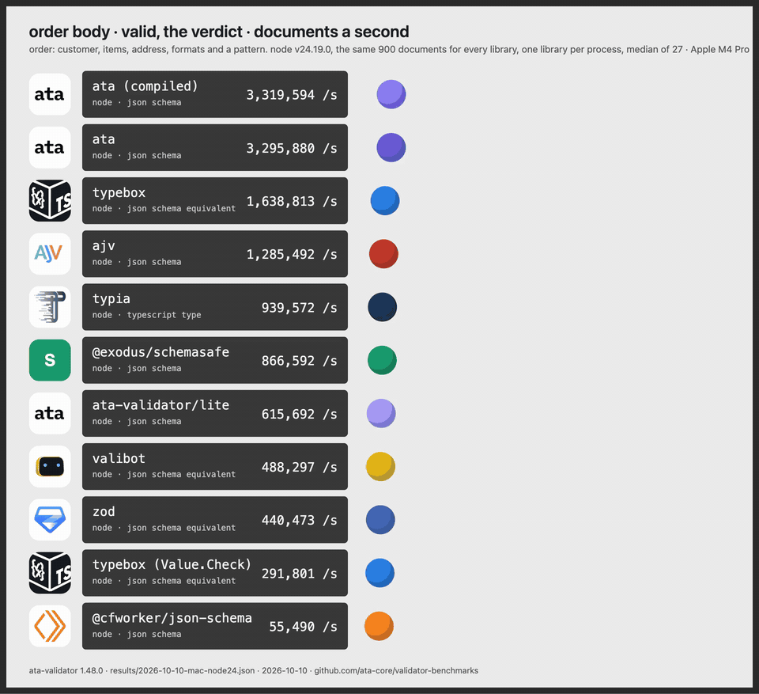
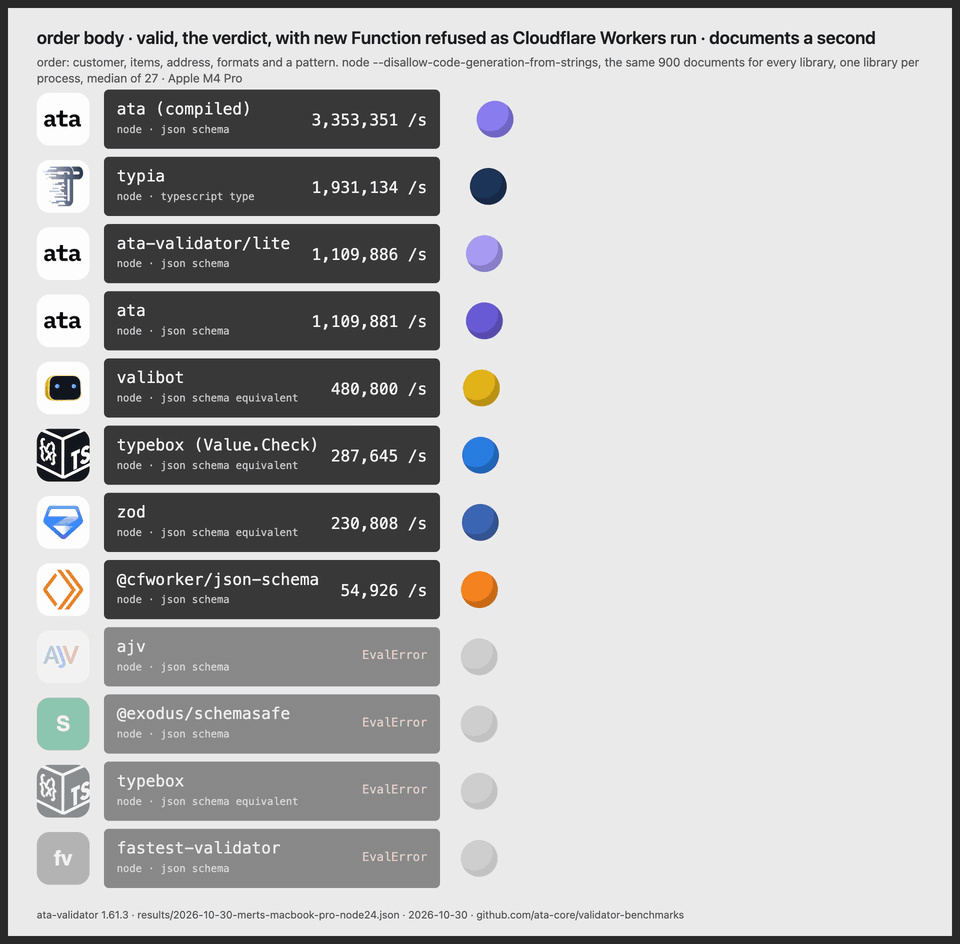

# validator-benchmarks

JSON Schema validators and their TypeScript-first equivalents on realistic API
bodies: documents a second, per scene, one library per process. Numbers in
[RESULTS.md](RESULTS.md); the raw samples, versions and machine in `results/`.

Maintained by the ata-validator project, so read it as such. Every library is
run from its published package at a pinned version, every schema is in the
repository, and a scene where ata is behind is in the table like the others.

## Bodies

| body | what it is | zod, valibot, typebox versions |
|---|---|---|
| user | 4 fields, a sign-up form (`bodies/user.schema.json`) | written by hand in `bodies/index.mjs` |
| order | customer, items with a sku pattern, address, uuid/email/date-time formats (`bodies/order.schemas.mjs`) | `bodies/order.*.mjs` |
| config | 25 sections, 30 KB of schema, 10 KB of document, shared definitions, `additionalProperties: false` | not written; JSON Schema libraries only |

Documents are generated deterministically or come from a committed corpus, so
every machine sees the same ones: 900 valid and 900 invalid users and orders,
120 of each config.

## Scenes

| scene | what is timed |
|---|---|
| verdict-valid | does the document pass; the boolean API where the library has one, `safeParse().success` otherwise |
| verdict-invalid | the same on documents that fail in one place |
| errors-invalid | every error of an invalid document produced and iterated, all errors on everywhere |
| blocked-verdict-valid | verdict-valid under `node --disallow-code-generation-from-strings`, the rule Cloudflare Workers and strict-CSP pages enforce; a library that compiles with `new Function` throws `EvalError` and is listed as such |

## Libraries

ata-validator (runtime, the compiled module of `ata compile`, the `/lite` entry
without the code generator, and `richErrors: false` in the errors scene), ajv
with ajv-formats, @exodus/schemasafe, @cfworker/json-schema, typebox
(TypeCompiler and Value.Check), zod, valibot. Formats are asserted everywhere;
typebox takes ajv-formats' checkers through its FormatRegistry.

## Method

`run.mjs` spawns one Node process per scene, body and library. The child
builds its adapter, checks that it answers every document the way the scene
expects (a mismatch is reported next to the number), warms up for 400 ms, then
takes 9 samples of about 20,000 documents each. The parent rotates through the
libraries three times, so 27 samples per cell, and keeps the median. Libraries
never share a heap or JIT feedback; in an earlier version that ran all of them
in one loop, the order they were warmed in showed in the numbers.

## Run it

```sh
npm ci
node run.mjs                                   # results/<date>-<host>.json
node report.mjs results/<date>-<host>.json     # RESULTS.md
node run.mjs --scene verdict-valid --body order
```

A GitHub Actions workflow runs the same on demand and monthly and attaches the
results; a runner's numbers are noisier than a desktop's and are not the ones
in RESULTS.md.

## The video

`node video/render.cjs results/<file>.json verdict-valid order out.mp4` renders
a scene and body as a bouncing-ball list (each ball crosses its lane at a rate
proportional to the row's throughput), 1920x1600, 60 fps, 10 s, through
Playwright and ffmpeg-static. `NAMES=a,b` keeps only those rows.





Full quality in `media/`: the two above, the order body with every error read (where ata's
default errors are behind ajv on the small body), and the config body. Logos are the projects' own, from their repositories
and sites; the Cloudflare Workers mark is from simple-icons.

## Adding a library or a body

An adapter is one `if` block in `impls/index.mjs` with a `verdict` and an
`errors` form and a `blocked` flag. A body is a JSON Schema, a documents
generator or corpus, and optionally the zod, valibot and typebox versions, in
`bodies/`. If a schema here is not what you would write, open an issue with the
version you would.
